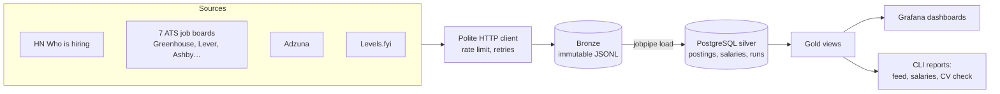

# Tech Jobs Pipeline

A data pipeline that collects public tech job postings across **Europe** (Spain, Germany, Switzerland and more) and turns
them into a dated dataset of what the market asks for: technologies, roles, seniority and salaries, month by month.
It ends in Grafana dashboards and in reports that compare a CV with the postings that fit it.

Built with **Python 3.11+, PostgreSQL, Grafana and Docker**, following a bronze / silver / gold (medallion) design.


## At a glance

| | |
|---|---|
| **What it does** | Collects postings from 10 public APIs (173 company job boards), cleans and deduplicates them, and serves dashboards and reports |
| **Data design** | Immutable raw layer (bronze, JSONL) → PostgreSQL silver tables → gold views for the dashboards |
| **Reliability** | Polite HTTP client with rate limiting, retries with backoff and `Retry-After`; atomic writes; full rebuilds from raw data |
| **Quality** | 148 tests (unit, property-based with Hypothesis, PostgreSQL integration), `ruff`, `mypy --strict`, CI on every PR |
| **Decisions** | 9 Architecture Decision Records in [`docs/adr`](docs/adr) |
| **Runtime deps** | None for the collectors (standard library only); `psycopg` for the warehouse |

## Architecture



## Engineering highlights

### Raw data is never modified

Every API item is written once, unchanged, to `data/bronze/source=<source>/ingest_date=<date>/run=<id>.jsonl`,
with a SHA-256 hash of the payload. Files are written to a temporary file and renamed atomically. A parsing bug is
fixed by reprocessing, never by collecting again, and silver and gold are rebuilt from bronze on every load.

### Dates that mean the same thing across sources

Sources disagree: some give a creation time, others a publication or update time, none says when a posting closed.
Each record keeps **three separate clocks** (when it was fetched, when the event happened, and first / last seen),
so trends month by month stay comparable ([ADR 0002](docs/adr/0002-bronze-layer-and-time-semantics.md)).

### Cleaning and counting each job once

On the way to silver every posting gets a city, ISO country codes, a remote flag, a seniority level and a role
read from its title, and a **job id**: the same job posted on several sources or once per city is counted once
([ADR 0008](docs/adr/0008-cleaning-postings.md)). Big tech employers are recognised whatever legal name they publish
under ("Google Switzerland GmbH", "Amazon Web Services EMEA SARL").

### Legal and polite collection

Only APIs meant for third parties are used. LinkedIn, jobs.ch and Levels.fyi pages are excluded because their terms
forbid automated collection ([ADR 0001](docs/adr/0001-data-sources.md),
[ADR 0003](docs/adr/0003-geographic-scope-and-excluded-sources.md)). The HTTP client keeps a bounded request rate,
honours `Retry-After`, and never writes query strings (which can hold API keys) to errors or logs.

### Measured performance

`benchmarks/load.py` loads synthetic data and times each step:

| Open postings | Bronze records | Build (Python) | Write (PostgreSQL) |
| ---: | ---: | ---: | ---: |
| 2,000 | 7,500 | 0.8 s | 0.3 s |
| 10,000 | 37,500 | 4.2 s | 0.5 s |
| 50,000 | 187,500 | 21.3 s | 2.1 s |

Profiling showed that technology detection (80 regular expressions over every description) took three quarters of
the build. A cheap substring pre-check before each regex cut the 2,000-posting build from **3.1 s to 0.8 s** with the
same result, which a property test verifies.

### Tests that look for edge cases

Besides unit tests, `tests/test_properties.py` uses **Hypothesis** to check rules that must hold for any input:
every title gets a known level and role, title normalisation is stable, grouping into jobs does not depend on input
order, salary ranges stay ordered. It found a real bug: "Data Engineer, FULL:TIME" was not recognised.
The warehouse tests load a fixture into PostgreSQL and run every dashboard query.

## What you get

- **Dashboards** (English and Spanish, in Grafana):
  - **For you**: open postings ranked by how well they fit your profile, and the technologies you are missing.
  - **Salaries**: p25 / median / p75 / p90 by region, role, seniority and company tier.
  - **Market**: postings per month and region, who is hiring, the most requested technologies over time.
  - **Pipeline health**: runs per source, days since the last collection, share of locations understood.
- **`jobpipe feed`**: the same ranked list on the command line.
- **`jobpipe salaries`**: a salary report for negotiating, never mixing currencies.
- **`jobpipe cv`**: compares a CV (text, Markdown or .docx) and a LinkedIn export with the postings that fit. It lists
  the keywords to add, what to learn, and the job titles the market uses. Personal files stay in a gitignored folder.
- **Add a posting by hand** from a form on the dashboards or from the command line, for sites with no public API.

## Tech stack

- **Language:** Python 3.11+ (standard library only for collection), packaged with `pyproject.toml`
- **Storage:** JSONL bronze layer, PostgreSQL 17 (silver tables and gold views), `psycopg` 3
- **Visualisation:** Grafana 11 with provisioned dashboards generated from code and a custom theme
- **Quality:** `unittest`, Hypothesis, `ruff`, `mypy --strict`
- **CI/CD and infrastructure:** GitHub Actions (lint, types, tests on Python 3.11 and 3.13, PostgreSQL service,
  Docker image build, Conventional Commits check), Docker Compose

## Running locally

```bash
pip install -e .[db]

# Collect
jobpipe ingest hn --since 2026-01-01        # HN "Who is hiring?" threads
jobpipe ingest ats                          # the boards in config/boards.toml
export ADZUNA_APP_ID=... ADZUNA_APP_KEY=... # free key from developer.adzuna.com
jobpipe ingest adzuna --country ch --country es --country de

# Warehouse and dashboards (PostgreSQL on 55432, Grafana on 3000, bound to 127.0.0.1)
docker compose up -d --build
cp config/profile.example.toml config/profile.toml   # your skills, roles and regions
jobpipe load
# open http://localhost:3000
```

Other commands:

```bash
jobpipe feed --days 7 --min-score 50
jobpipe salaries --region ch --title "data|backend"
jobpipe cv --cv private/cv.md --linkedin private/linkedin-export.zip
jobpipe discover-boards --region ch --region es --region eu
```

## Development

```bash
pip install -e .[dev,db]
ruff check src tests grafana benchmarks
mypy
PYTHONPATH=src python -m unittest discover -s tests -t .
```

Dashboards are generated by `grafana/build_dashboards.py`; CI fails if the committed JSON differs.
Commits follow [Conventional Commits](https://www.conventionalcommits.org/), and decisions that are hard to reverse
get an ADR in [`docs/adr`](docs/adr).

## Status and next steps

Ingestion, the silver layer and the dashboards are working. Next steps:

- [ ] Daily scheduling with CronJobs on a local Kubernetes (k3d) cluster
- [ ] Gold models in dbt
- [ ] More European sources (German and Spanish job boards)
- [ ] Alerts when a source returns nothing

Kafka was considered and left out: sources are polled once a day, so a queue would add moving parts without
changing what the data can answer.

## Data and attribution

Collected data is not committed. Adzuna data shown publicly must credit Adzuna; Levels.fyi data must say
"Data source: Levels.fyi (https://www.levels.fyi)". Postings belong to their publishers; only aggregated statistics
are published.

## Author

**Lorenzo Sanz Cerveró**, backend developer:
[LinkedIn](https://www.linkedin.com/in/lorenzo-sc) · [GitHub](https://github.com/LorenzoSanz)

MIT License.
